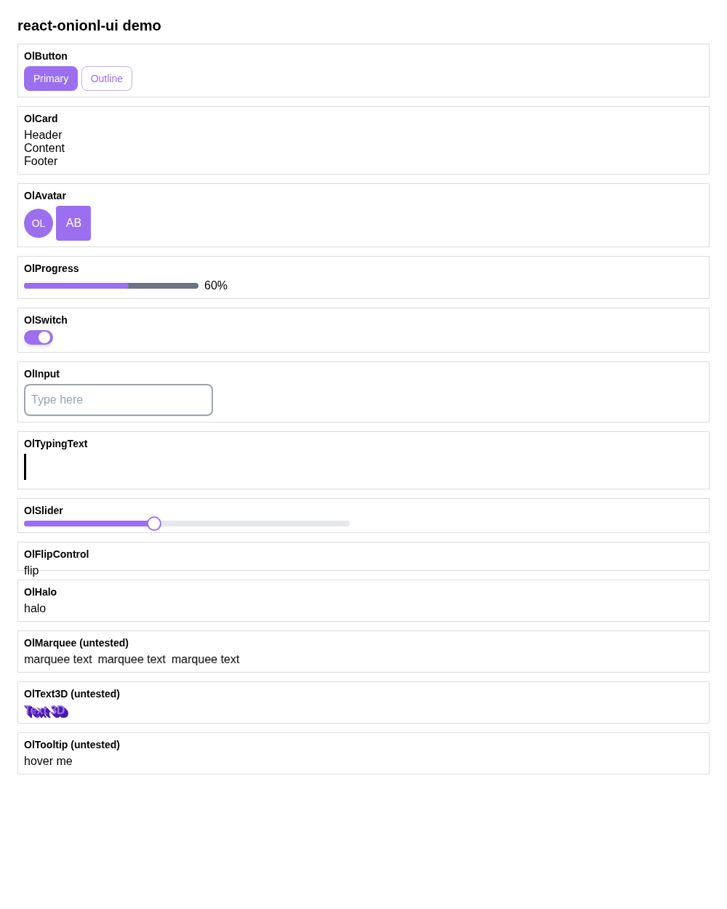

# react-onionl-ui

React UI components (button, input, avatar, card, switch, slider, progress, tour, context menu,
draggable list, flip card and more), migrated from the Vue library
[onionl-ui](https://github.com/Onion-L/onionl-ui) (commit `41af9cc`).



## How it was made

The migration was done by an LLM (gpt-6-luna), not by hand, as an exploration in a master's
thesis on test-based evaluation of LLM-supported code migration between React and Vue. It follows
[react-audio-visual](https://github.com/niclas-j/react-audio-visual) on a larger library.

1. The library was split into 22 tasks: 21 components and the library entry `index.ts`. Each task
   is one symbol with its dependencies, migrated against its original tests ported to React Testing
   Library (19 test suites ported by the same model, 3 reused).
2. Migration ran bottom-up in three layers. Layer 1 migrated every component on its own. Files that
   several tasks share (icon, the install helper, the flip and draggable-item parts) were then frozen,
   picking per file without a model the version that passes the most tests of its users. Layer 2
   migrated the components that use them again, with the frozen files given and unchangeable.
   Layer 3 migrated only the remaining untested modules and the entry file on top of everything frozen.
3. Every task was run three times; the best run per file went into this repository.

| Step | Runs passed |
|---|---|
| Layer 1, 21 components | 60 / 63 (only input fails) |
| Layer 2, 5 components on frozen shared files | 12 / 15 (input again) |
| Layer 3, untested modules and entry | 3 / 3 |

Merged into one library:

| Variant | Tests passed | Build |
|---|---|---|
| Per task, merged file by file without bottom-up | 145 / 148 | ok, untested modules empty |
| **Bottom-up (this repository)** | **150 / 151** | ok after one import fix |
| Whole library in one prompt (3 runs) | 110–114 / 148 | fails |

The whole run (test porting and migration) took 547 model calls and cost about 0.36 USD at list price.

## What was changed by hand

The code is published as the model produced it, apart from:

- one import in `avatar/src/group.tsx` (`./avatar` resolved to the props-types file `avatar.ts`
  instead of the component `avatar.tsx`, which broke the build),
- build, test and demo configuration, and the copied UnoCSS preset in `preset/`.

## Status

- `npm test`: 150 of 151 tests pass. The failing test (input, `applies mask when provided`) is a
  defect of the ported test: it calls `toHaveValue` with a regular expression, which compares by
  equality and can never pass.
- `npm run typecheck`: 11 type errors remain in component code (mostly a missing `class` prop in
  props types) and 8 in tests. The build is not affected.
- Avatar group, dialog card, marquee, popover, text 3D and tooltip have no tests; they are only
  checked by the build and the demo.
- Not published to npm. Not reviewed beyond the tests and a visual check in the demo.

## Styling

As in the original, the components carry class names only. Styles come from the onionl-ui UnoCSS
preset, copied to `preset/`. Use it in your UnoCSS config:

```ts
import { defineConfig } from 'unocss'
import { onionlUIPreset } from './preset'

export default defineConfig({ presets: [onionlUIPreset()] })
```

and import `virtual:uno.css` in your entry, as `demo/main.tsx` does.

## Usage

```tsx
import { OlButton, OlInput, OlSwitch } from 'react-onionl-ui'

<OlButton type="outline">Save</OlButton>
<OlInput placeholder="Name" />
<OlSwitch checked />
```

## Development

```bash
npm install
npm test
npm run typecheck
npm run build
npm run demo
```

`.npmrc` sets `legacy-peer-deps`, because UnoCSS 0.64 lists Vite only up to version 5 as a peer.

## License

MIT, see [LICENSE](LICENSE). Original work copyright XL (Onion-L).
